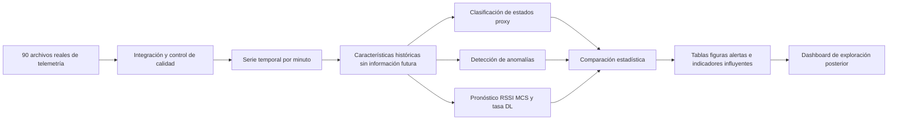

# Producto tecnológico de la tesis de Ubelser Tamay

## Identificación precisa

**Producto de tesis:** sistema computacional modular, basado en analítica temporal, para diagnóstico y pronóstico de indicadores operacionales del radioenlace rural Cuñacales–San José. Se construyó y evaluó con datos históricos de un escenario real; su implementación científica consiste en los módulos Python de la carpeta src/radioenlace/ y en los scripts de ejecución.

**Extensión posterior:** dashboard en dashboard/app.py, creado para facilitar su demostración y el examen de resultados. No es una interfaz implementada durante la adquisición ni un sistema de monitoreo RF en vivo.

## Entradas → transformación → salidas

## Relación entre producto, objetivos y resultados

| Objetivo específico | Componente/producto verificable | Evidencia publicada | Límite |
|---|---|---|---|
| OE1. Construir un conjunto temporal depurado | Flujo de integración AP y calidad | 90 archivos; 173 513 registros; 118 458 minutos observados | 65,80 % de cobertura, no serie ininterrumpida |
| OE2. Diseñar e implementar los módulos | Código ejecutable y pruebas funcionales | scripts, configuración, módulos y registros de salida | Comprobación funcional no equivale a superioridad predictiva |
| OE3. Comparar diagnóstico y pronóstico | Modelos, referencias, métricas y bootstrap | F1/AUC, MAE/RMSE, matriz de confusión, figuras | La mejora del F1-macro no fue concluyente |
| OE4. Anticipar y explicar | Alertas a 15 min e importancia por permutación | 723 de 1 548 condiciones proxy anticipadas en el resultado publicado; SNR DL influyente | No existen etiquetas completas de incidencias de campo |

## ¿Qué puede mostrar el sustentante?

1. Abrir el repositorio y su versión científica v1.0.0.
2. Mostrar los archivos fuente con SHA-256, la configuración y el script único run_all.py.
3. Abrir las tablas y figuras publicadas, separando las métricas del sistema y las de persistencia.
4. Ejecutar el dashboard para explorar fechas, variables, horizontes y alertas.
5. Enseñar el resultado de una auditoría independiente, incluyendo **cualquier divergencia**, sin alterar cifras ni esconder discrepancias.

## Reproducción científica frente a uso del software

El hecho de poder ejecutar una interfaz no demuestra que los resultados originales se reproduzcan numéricamente. La reproducción requiere un entorno documentado, repetir el análisis desde Datos.zip y contrastar las salidas con la referencia sellada. Véase docs/reproducibilidad/GUIA_AUDITORIA.md.

## Alcance académico

El caso prueba una metodología aplicada a una infraestructura real de telecomunicaciones en Cajamarca. Contribuye como **ruta potencial de investigación para la Universidad Nacional de Cajamarca**, no como validación general de cualquier radioenlace. Los umbrales operacionales, las etiquetas proxy y los modelos requieren recalibración y validación independiente antes de desplegarlos en otros enlaces.
